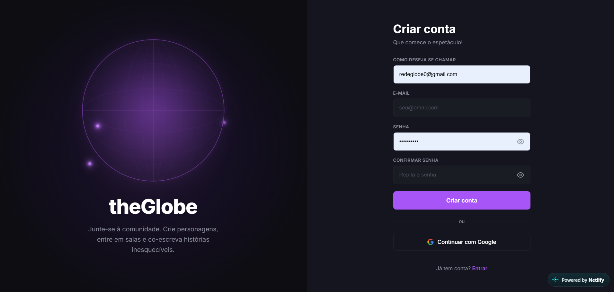
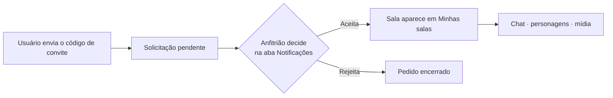

<p align="center">
  
</p>

<p align="center">
  
  
  
  
  
</p>

<p align="center">
  <a href="https://theglobe0.netlify.app/">
    
  </a>
</p>

<p align="center">
  <b>Aplicação web para criar salas de conversa e encenação, organizar personagens e compartilhar mídia com os participantes.</b><br>
  Interface em português · Aplicação estática · Supabase para Auth, banco, arquivos e tempo real
</p>

<p align="center">
  <a href="https://theglobe0.netlify.app/">Site</a> ·
  <a href="#-destaques">Destaques</a> ·
  <a href="#-telas-e-funcionalidades">Telas</a> ·
  <a href="#-como-funciona-uma-sala">Salas</a> ·
  <a href="#-serviços-e-dados">Serviços</a> ·
  <a href="#-desenvolvimento-e-publicação">Publicação</a> ·
  <a href="#-limitações-conhecidas">Limitações</a>
</p>

---

## ✨ Destaques

| 🔐 Acesso com Google | 📱 Desktop e mobile | ⚡ Tempo real |
|:---:|:---:|:---:|
| Login com e-mail e senha ou OAuth do Google via Supabase Auth | Layout responsivo: navegação lateral no desktop, barra compacta no celular | Mensagens, presença, digitação, personagens e mídia sincronizados pelo Realtime |

| 🎭 Encenação | 🗂️ Carteira de personagens | 🎬 Transmissão de vídeo |
|:---:|:---:|:---:|
| Mensagens com a identidade e a cor do personagem ativo | Personagens organizados em pastas | O anfitrião transmite vídeos sincronizados para toda a sala |

<p align="center">
  
</p>

## 📑 Índice

- [Telas e funcionalidades](#-telas-e-funcionalidades)
- [Como funciona uma sala](#-como-funciona-uma-sala)
- [Serviços e dados](#-serviços-e-dados)
- [Configuração do Supabase](#-configuração-do-supabase-auth-e-google)
- [Desenvolvimento e publicação](#-desenvolvimento-e-publicação)
- [Limitações conhecidas](#-limitações-conhecidas)

## 🖥️ Telas e funcionalidades

<details open>
<summary><b>🔐 Cadastro e acesso</b> — <code>index.html</code></summary>

- Criação de conta com nome, e-mail e senha, incluindo confirmação da senha.
- Login com e-mail e senha.
- Autenticação por **Google** via Supabase Auth.
- Alternância entre os formulários de cadastro e login e controle para mostrar/ocultar a senha.
- Páginas internas verificam a sessão e encaminham para a tela de acesso quando não há usuário autenticado.
</details>

<details>
<summary><b>🚪 Salas</b> — <code>rooms.html</code></summary>

- Lista as salas criadas pelo usuário e as salas em que ele foi aceito como membro. A lista é individual por conta.
- Exibe capa, nome, total de membros e nome do anfitrião que criou a sala.
- Criação de sala com nome, imagem de capa, wallpaper opcional para o chat e marcadores dos modos Encenação e Exibição.
- Edição do nome, capa e wallpaper; exclusão da sala pelo anfitrião.
- Entrada em outra sala com código de convite de seis caracteres. O pedido fica pendente até o anfitrião aceitar ou rejeitar.
- Aba de notificações com pedidos pendentes para as salas do usuário anfitrião. Novos pedidos chegam pelo Supabase Realtime.
</details>

<details>
<summary><b>🎭 Carteira de personagens</b> — <code>personagens.html</code></summary>

- Criação, edição e exclusão de personagens pertencentes à conta autenticada.
- Cada personagem pode ter nome, descrição, imagem, cor e iniciais de fallback.
- Organização em pastas: criar, abrir, renomear e excluir. Excluir uma pasta mantém os personagens e os move para “Sem pasta”.
- Personagens sem pasta também podem ser encontrados na carteira.
- Ao criar ou editar um personagem, é possível escolher a pasta.
- Na seleção de personagem dentro de uma sala, a carteira também é navegada por pastas.
</details>

<details>
<summary><b>👤 Perfil</b> — <code>profile.html</code></summary>

- Exibe nome, e-mail, foto, faixa colorida do perfil e quantidade de salas criadas pela própria conta.
- Permite alterar o nome de usuário, enviar uma foto de perfil e escolher a cor do banner.
- A imagem de perfil é enviada ao Storage e sua URL é salva nos metadados do usuário.
- Inclui encerramento da sessão.
</details>

<details>
<summary><b>💬 Chat</b> — <code>chat.html?id=&lt;id-da-sala&gt;</code></summary>

- Mostra o nome da sala, código copiável de convite, participantes online e seus avatares.
- Mantém histórico de mensagens no banco de dados. Mensagens novas são exibidas sem depender de recarregar a página.
- Exibe o nome e a foto do usuário que enviou a mensagem. Mensagens de personagem usam foto e cor do personagem; mensagens sem personagem usam a identidade e a foto da conta.
- Clicar na foto de um personagem em uma mensagem abre o perfil daquele personagem.
- Resposta a uma mensagem pelo menu contextual. Mensagens respondidas mostram uma referência clicável à mensagem original.
- O autor pode apagar a própria mensagem. Ela permanece no histórico como “Esta mensagem foi apagada”, e a referência a ela também é atualizada.
- Indicador de digitação dos demais participantes.
- Faixa de personagens da sala: adicionar personagens da carteira, selecionar qual personagem está ativo, assumir personagens livres e soltar ou remover personagens conforme a posse.
- Clique com o botão direito em um personagem abre as ações disponíveis para aquele personagem.
- O modo Encenação pode ser ativado ou desativado no chat. Com personagem ativo, as mensagens usam a identidade e a cor dele; sem personagem ativo, usam a identidade da conta.
- No celular, as opções da sala podem ser expandidas ou recolhidas. O painel contém o convite e, para o anfitrião, os controles de mídia.
</details>

<details>
<summary><b>🎬 Transmissão de mídia na sala</b></summary>

- Somente o anfitrião da sala pode adicionar arquivos de vídeo, escolher um vídeo da biblioteca, transmitir e excluir arquivos.
- O vídeo ocupa a tela durante a transmissão. O anfitrião pode interrompê-la; a interrupção é enviada aos participantes.
- Os demais integrantes recebem o estado do vídeo — posição, reprodução/pausa e velocidade — e carregam o mesmo arquivo da biblioteca da sala.
- A reprodução pode exigir uma ação do participante para liberar o áudio, conforme as regras de reprodução automática do navegador.
- Os controles são exibidos no chat apenas para o anfitrião. Em telas mobile eles ficam dentro do painel recolhível “Expandir opções”.
</details>

<details open>
<summary><b>📱 Layout responsivo</b> — desktop e mobile</summary>

- Em telas estreitas, a navegação lateral transforma-se em uma barra horizontal compacta.
- Formulários, cartões, salas, perfil e carteira reorganizam-se para caber em celular.
- O cabeçalho, a faixa de personagens, as mensagens e o compositor do chat ajustam espaçamentos e largura.
- Os controles de transmissão podem ser recolhidos no celular; em desktop, o layout mantém a navegação lateral e os controles do anfitrião.
</details>

## 🧭 Como funciona uma sala



1. O usuário cria uma sala ou envia um código de convite de outra sala.
2. O convite cria uma solicitação pendente; o anfitrião aceita ou rejeita na aba **Notificações**.
3. Após ser aceito, o usuário encontra a sala em **Minhas salas** e pode abri-la.
4. Dentro do chat, cada participante pode adicionar personagens da própria carteira. Personagens livres podem ser assumidos; personagens em uso ficam identificados pelo participante que os controla.
5. As mensagens são gravadas em `public.messages`. Broadcast e eventos Postgres Changes distribuem atualizações em tempo real; há também uma consulta de recuperação periódica para cobrir eventos perdidos.
6. Se o anfitrião usar a transmissão, ele seleciona um vídeo da biblioteca da sala. Todos os membros carregam esse mesmo arquivo e recebem os comandos de sincronização pelo canal Realtime.

## 🗄️ Serviços e dados

### Supabase

O cliente está em `src/js/config/supabase.js`. O projeto usa:

| Recurso | Uso |
|---|---|
| **Auth** | Sessão, cadastro por e-mail/senha e OAuth com Google |
| **Postgres** | Salas, membros, solicitações, mensagens, personagens e pastas |
| **Storage** | Avatares, capas, wallpapers e vídeos das salas |
| **Realtime** | Presença, digitação, novas mensagens, personagens, notificações de entrada e estado da mídia |

### Tabelas e recursos usados pelo cliente

O código consulta as tabelas `rooms`, `room_members`, `room_requests`, `messages`, `characters` e `room_characters`. A migração de pastas adiciona `character_folders` e `characters.folder_id`. As colunas-base dessas tabelas devem existir antes de aplicar as migrações listadas abaixo; a configuração inicial do esquema base não está incluída neste repositório.

As funções RPC usadas incluem:

- `get_room_user_profiles(p_room_id)` — entrega os nomes e avatares públicos dos participantes de uma sala.
- `delete_own_room_message(p_message_id)` — apaga uma mensagem própria sem removê-la do histórico.

### Migrações incluídas

Aplicar na ordem dos nomes pelo SQL Editor do Supabase, após criar o esquema base:

| # | Arquivo | O que faz |
|:-:|---|---|
| 1 | `supabase/migrations/20261024000000_room_media_broadcast.sql` | Políticas para listar, enviar e apagar mídia da sala e para receber/transmitir o estado de vídeo pelo Realtime |
| 2 | `supabase/migrations/20261024000100_room_user_display_names.sql` | RPC segura para buscar nomes e avatares dos integrantes de uma sala |
| 3 | `supabase/migrations/20261025000100_room_message_replies_and_deletion.sql` | Campos de resposta e exclusão lógica, além da RPC de exclusão da própria mensagem |
| 4 | `supabase/migrations/20261025000200_character_folders.sql` | Tabela de pastas, políticas RLS e vínculo entre pasta e personagem |

> [!NOTE]
> As migrações não criam todo o banco do theGlobe: elas adicionam recursos ao esquema base já existente. Antes de publicar, confira as políticas RLS das tabelas principais e buckets de avatar/capa; as políticas adicionais necessárias a estes recursos não são todas definidas neste conjunto de migrações.

### Buckets de Storage

- `avatars`: usado para fotos de perfil.
- `rooms`: usado para capas, wallpapers e arquivos de vídeo. A migração de mídia protege os arquivos em `media/<id-da-sala>/...` para que somente o anfitrião possa enviar/apagar e somente membros autorizados possam listar.

O cliente usa URLs públicas para exibir imagens. Revise a configuração e as políticas dos buckets no painel do Supabase para compatibilizar leitura pública de imagens com as permissões de upload apropriadas.

### Realtime e permissões

Habilite no Supabase os recursos Realtime para os canais usados e a publicação de mudanças das tabelas que precisam emitir eventos, principalmente `messages`, `room_characters` e `room_requests`. A migração de mídia adiciona políticas em `realtime.messages`, mas o projeto também precisa ter Realtime habilitado e as políticas/tabelas configuradas corretamente.

As validações na interface ajudam a orientar o usuário, mas não substituem políticas de segurança no banco. Configure RLS para limitar cada conta às próprias pastas/personagens, cada anfitrião às próprias salas e cada membro aos dados da sala a que foi aceito.

## 🚀 Desenvolvimento e publicação

### Requisitos

- Node.js com npm, para gerar a pasta de publicação.
- Um projeto Supabase configurado com Auth, banco, Storage, Realtime e esquema compatíveis.
- Um servidor HTTP local para abrir os arquivos durante o desenvolvimento. Como o front-end usa módulos ES e imports remotos do Supabase, abrir as páginas diretamente como `file://` não é o fluxo recomendado. Pode-se usar a extensão Live Server do VS Code ou outro servidor estático.

### Gerar o site

Na raiz do repositório:

```powershell
npm install
npm run build
```

O script `scripts/build.mjs` recria `dist` e copia as cinco páginas publicadas (`index.html`, `rooms.html`, `personagens.html`, `profile.html` e `chat.html`), a pasta `src` e os arquivos de `public`. A página de entrada é `index.html`.

Para publicação manual no Netlify, envie o conteúdo da pasta `dist`. A configuração `netlify.toml` usa o comando `npm run build` e publica `dist` em deploys conectados ao repositório.

### Configuração do Supabase Auth e Google

- Defina a URL do site e os redirect URLs permitidos nas configurações de Auth do Supabase.
- Para Google, configure o provedor OAuth no Supabase e os endereços de callback exigidos pelo painel do Supabase/Google.
- A aplicação retorna o usuário para `/profile.html` após o OAuth.
- Verifique a configuração de confirmação de e-mail: o fluxo da interface redireciona após cadastro, mas o comportamento efetivo depende das opções de confirmação do projeto Supabase.

## ⚠️ Limitações conhecidas

- A sincronização de mensagens combina Realtime com uma consulta periódica de recuperação a cada 2,5 segundos; portanto, a consulta de fallback não é a fonte de latência instantânea.
- Sincronização de mídia depende de Realtime, Storage, permissões corretas e disponibilidade do mesmo arquivo para todos. Navegadores podem bloquear autoplay com áudio até uma interação do usuário.
- A migração de exclusão de mensagens permite excluir apenas mensagens próprias. O anfitrião não tem, na implementação atual da interface/RPC, um fluxo de exclusão de mensagens de terceiros.
- No perfil, a contagem de salas é carregada com base em salas criadas pelo usuário. Os campos visuais de contagem de personagens e mensagens ainda não são preenchidos pela rotina atual.
- O botão **Alterar senha** aparece na lista de ações do perfil, mas ainda não possui fluxo de alteração implementado.
- Sem foto cadastrada, a interface utiliza o ícone padrão de usuário; personagens sem imagem usam iniciais.

---

<p align="center"><sub>theGlobe · que comece o espetáculo ✨</sub></p>
