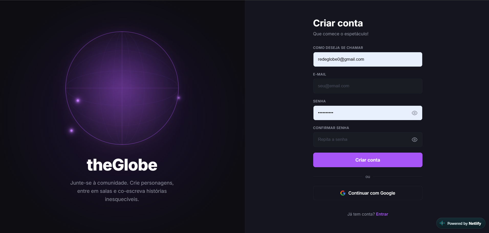

<p align="center">
  
</p>

<p align="center">
  
  
  
  
  
</p>

<p align="center">
  <a href="[https://theglobe.com.br/](https://the-globe-web.theglobeweb.workers.dev/)">
    
  </a>
</p>

<p align="center">
  <b>Aplicação web para criar salas de conversa e encenação, organizar personagens e compartilhar mídia com os participantes.</b><br>
  Interface em português · Aplicação estática · Supabase para Auth, banco, arquivos e tempo real
</p>

<p align="center">
  <a href="https://theglobe.com.br/">Site</a> ·
  <a href="#-destaques">Destaques</a> ·
  <a href="#-telas-e-funcionalidades">Telas</a> ·
  <a href="#-como-funciona-uma-sala">Salas</a> ·
  <a href="#-serviços-e-dados">Serviços</a> ·
  <a href="#-desenvolvimento-e-publicação">Publicação</a> ·
  <a href="#-limitações-conhecidas">Limitações</a>
</p>

---

## ✨ Destaques

| 🔐 Acesso com Google | 📱 Desktop e mobile | ⚡ Tempo real & Performance |
|:---:|:---:|:---:|
| Login com e-mail e senha ou OAuth do Google via Supabase Auth | Layout responsivo: navegação lateral no desktop, rolagem suave e barra compacta no celular | Mensagens, presença, digitação e personagens sincronizados via Realtime com polling otimizado |

| 🎭 Encenação | 🗂️ Carteira de personagens | 🎬 Transmissão de vídeo |
|:---:|:---:|:---:|
| Mensagens com a identidade e a cor do personagem ativo | Personagens organizados em pastas | O anfitrião transmite vídeos sincronizados para toda a sala |

<p align="center">
  
</p>

## 📑 Índice

- [Telas e funcionalidades](#-telas-e-funcionalidades)
- [Como funciona uma sala](#-como-funciona-uma-sala)
- [Serviços e dados](#-serviços-e-dados)
- [Configuração do Supabase](#-configuração-do-supabase-auth-e-google)
- [Desenvolvimento e publicação](#-desenvolvimento-e-publicação)
- [Limitações conhecidas](#-limitações-conhecidas)

## 🖥️ Telas e funcionalidades

<details open>
<summary><b>🔐 Cadastro e acesso</b> — <code>index.html</code></summary>

- Criação de conta com nome, e-mail e senha, incluindo confirmação da senha.
- Login com e-mail e senha.
- Autenticação por **Google** via Supabase Auth.
- Alternância entre os formulários de cadastro e login e controle para mostrar/ocultar a senha.
- Páginas internas verificam a sessão e encaminham para a tela de acesso quando não há usuário autenticado.
</details>

<details>
<summary><b>🚪 Salas</b> — <code>rooms.html</code></summary>

- Lista as salas criadas pelo usuário e as salas em que ele foi aceito como membro. A lista é individual por conta.
- Exibe capa, nome, total de membros e nome do anfitrião que criou a sala.
- Criação de sala com nome, imagem de capa, wallpaper opcional para o chat e marcadores dos modos Encenação e Exibição.
- Edição do nome, capa e wallpaper; exclusão da sala pelo anfitrião.
- Entrada em outra sala com código de convite de seis caracteres. O pedido fica pendente até o anfitrião aceitar ou rejeitar.
- Aba de notificações com pedidos pendentes para as salas do usuário anfitrião. Novos pedidos chegam pelo Supabase Realtime.
</details>

<details>
<summary><b>🎭 Carteira de personagens</b> — <code>personagens.html</code></summary>

- Criação, edição e exclusão de personagens pertencentes à conta autenticada.
- Cada personagem pode ter nome, descrição, imagem, cor e iniciais de fallback.
- Organização em pastas: criar, abrir, renomear e excluir. Excluir uma pasta mantém os personagens e os move para “Sem pasta”.
- Personagens sem pasta também podem ser encontrados na carteira.
- Ao criar ou editar um personagem, é possível escolher a pasta.
- Na seleção de personagem dentro de uma sala, a carteira também é navegada por pastas.
</details>

<details>
<summary><b>👤 Perfil</b> — <code>profile.html</code></summary>

- Exibe nome, e-mail, foto, faixa colorida do perfil e quantidade de salas criadas pela própria conta.
- Permite alterar o nome de usuário, enviar uma foto de perfil e escolher a cor do banner.
- A imagem de perfil é enviada ao Storage e sua URL é salva nos metadados do usuário.
- Inclui encerramento da sessão.
</details>

<details>
<summary><b>💬 Chat</b> — <code>chat.html?id=&lt;id-da-sala&gt;</code></summary>

- Mostra o nome da sala, código copiável de convite, participantes online e seus avatares.
- Mantém histórico de mensagens no banco de dados. Mensagens novas são exibidas sem depender de recarregar a página.
- Exibe o nome e a foto do usuário que enviou a mensagem. Mensagens de personagem usam foto e cor do personagem; mensagens sem personagem usam a identidade e a foto da conta.
- Clicar na foto de um personagem em uma mensagem abre o perfil daquele personagem.
- Resposta a uma mensagem pelo menu contextual. Mensagens respondidas mostram uma referência clicável à mensagem original.
- O autor pode apagar a própria mensagem. Ela permanece no histórico como “Esta mensagem foi apagada”, e a referência a ela também é atualizada.
- Indicador de digitação dos demais participantes.
- Faixa de personagens da sala com rolagem horizontal suave dedicada no desktop e comportamento otimizado no mobile: adicionar personagens da carteira, selecionar qual personagem está ativo, assumir personagens livres e soltar ou remover personagens conforme a posse.
- Clique com o botão direito em um personagem abre as ações disponíveis para aquele personagem.
- O modo Encenação pode ser ativado ou desativado no chat. Com personagem ativo, as mensagens usam a identidade e a cor dele; sem personagem ativo, usam a identidade da conta.
- No celular, as opções da sala podem ser expandidas ou recolhidas. O painel contém o convite e, para o anfitrião, os controles de mídia.
</details>

<details>
<summary><b>🎬 Transmissão de mídia na sala</b></summary>

- Somente o anfitrião da sala pode adicionar arquivos de vídeo, escolher um vídeo da biblioteca, transmitir e excluir arquivos.
- O vídeo ocupa a tela durante a transmissão. O anfitrião pode interrompê-la; a interrupção é enviada aos participantes.
- Os demais integrantes recebem o estado do vídeo — posição, reprodução/pausa e velocidade — e carregam o mesmo arquivo da biblioteca da sala.
- A reprodução pode exigir uma ação do participante para liberar o áudio, conforme as regras de reprodução automática do navegador.
- Os controles são exibidos no chat apenas para o anfitrião. Em telas mobile eles ficam dentro do painel recolhível “Expandir opções”.
</details>

<details open>
<summary><b>📱 Layout responsivo</b> — desktop e mobile</summary>

- Em telas estreitas, a navegação lateral transforma-se em uma barra horizontal compacta.
- Formulários, cartões, salas, perfil e carteira reorganizam-se para caber em celular.
- O cabeçalho, a faixa de personagens, as mensagens e o compositor do chat ajustam espaçamentos e largura.
- Os controles de transmissão podem ser recolhidos no celular; em desktop, o layout mantém a navegação lateral e os controles do anfitrião.
</details>

## 🧭 Como funciona uma sala

```mermaid
flowchart LR
    A["Usuário envia o código de convite"] --> B["Solicitação pendente"]
    B --> C{"Anfitrião decide<br/>na aba Notificações"}
    C -->|Aceita| D["Sala aparece em Minhas salas"]
    C -->|Rejeita| F["Pedido encerrado"]
    D --> E["Chat · personagens · mídia"]
